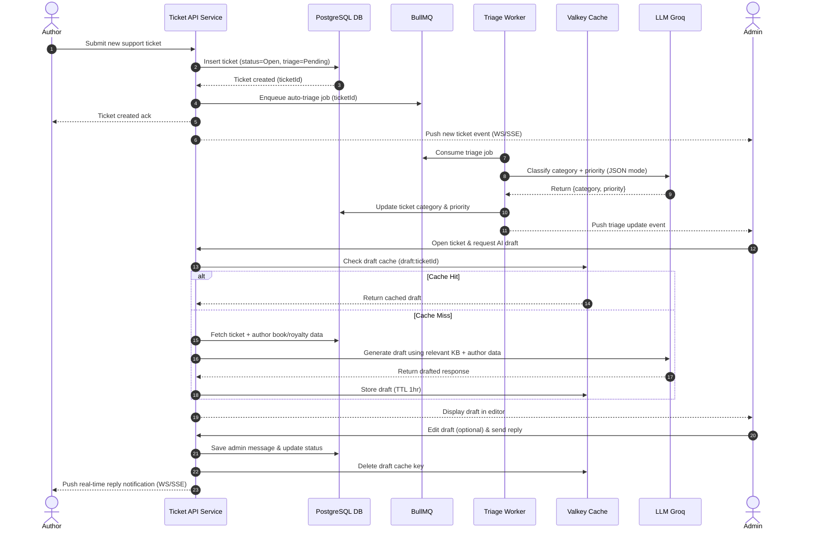

# this is how the ai ticket & draft system of this project should be operated

### first how to handel tickets, triage and drafts

-- when a new ticket is submited by author we first save it to postgress database immediately so data is never lost even if ai fails
-- right after db insert we push a triage job to bullMq and broadcast the new ticket to admin portal via websockets/sse so admin sees it instantly
-- the background worker picks up the job and calls llm (in our case Groq) with structured json output to get category and priority score, then updates postgress and notifies admin UI
-- for drafting responses we dont auto generate on ticket creation to save cost. instead when admin opens a ticket we check valkey cache first (`draft:ticketId`). if not there, we generate draft via groq, cache it in valkey with a ttl, and send to admin
-- admin can edit the draft or override category/priority and hit send. when sent it saves to postgress, clears the valkey draft cache, and pushes real time update to the author's ticket view

### when to feed the bookleaf knowledge base and author info to llm

-- first of all we will separate triage calls from draft calls so we dont waste tokens
-- for auto-triage (classification + priority):
- we only send ticket subject, description, and the list of valid categories + priority rules. we dont feed the whole knowledge base or author royalty history here cause its not needed just to categorize
-- for draft response generation (when admin opens ticket):
- we already know the classified category from step 1! so we only inject that specific slice of the bookleaf knowledge base (like if category is Royalty & Payments, only feed Royalty Policy + Communication Tone Guidelines). no heavy RAG vector db needed since the kb is small and structured
- we also fetch only the specific book and royalty numbers tied to `ticket.bookId` from postgress and inject that as context so the llm gives exact dates and ₹ amounts instead of generic fluff

### how to handel context window & token cost

-- since tickets are thread based and not endless live chats, we dont need a 120k threshold
-- for threads with multiple back-and-forth replies between author and admin, we cap the context to the last 5 messages + the original ticket query + specific book stats
-- we also cache the generated draft in valkey (`draft:ticketId`) so if 2 admins open the same ticket or an admin refreshes the page, we dont hit groq api twice for the same state

### error handeling

-- if groq responds with rate limiting (429) or timeout/500 during auto-triage:
- bullMq retries the job 2 times with exponential backoff. if it still fails, worker marks ticket category as `Needs Manual Triage` and priority as `Medium` so the ticket is still visible in the queue
-- if groq fails when admin opens ticket to generate a draft:
- api catches the error gracefully, returns a fallback flag `{ aiAvailable: false }`, and the admin UI simply shows an empty text box with a small notice so admin can type and send the response manually without blocking workflow
